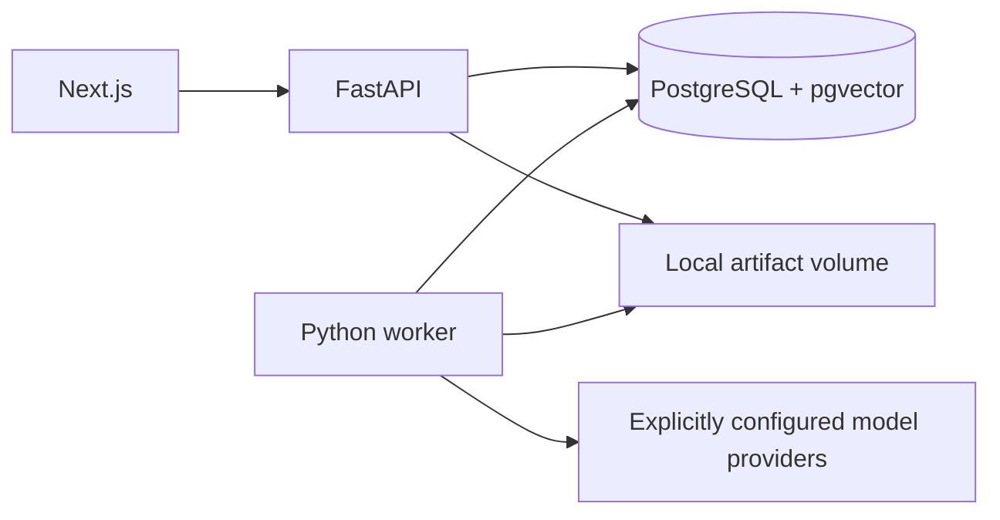

# Architecture

## Approved approach
A modular application plus separate worker in one repository. Next.js presents the UI; FastAPI validates requests and exposes resources; a Python worker performs heavy ingestion and experiments. PostgreSQL/pgvector stores metadata, jobs, normalized content, vectors, and results. Original files and exports live on a persistent local volume.

## Repository layout
apps/web/; services/api/; packages/rag_core/; services/worker/; migrations/; tests/; research/; skills/; docs/; infra/. Keep the Python core independent of HTTP/UI concerns. API and worker share schema/configuration and invoke the same pipeline modules.

Foundation creates apps/web, services/api, services/worker, packages/rag_core, migrations, tests, skills, infra, and scripts. research/docs directories arrive with artifacts. The worker processes durable ingestion, lexical/dense index builds, and dense query previews, rotating queue priority. Dataset curation/publication and bounded lexical inspection run in the API; durable experiment execution remains M4 work. Readiness verifies the exact migration revision and pgvector. Next.js proxies service status. Docker builds enable standalone output; native builds support ordinary next start.

## Pipeline
Upload draft → extraction/normalization → canonical sections with source locations → publication → chunk/index variant → dataset publication → immutable run manifest → retrieval → context packing → generation → evaluation → aggregation/export.
Index variants are keyed by corpus version, chunking configuration, embedding model revision, tokenizer, and normalization version. Retrieval does not alter corpus snapshots.

## Job execution
PostgreSQL-backed jobs use transactional claims with row locking, ownership tokens, lease expiry, and heartbeats. Expired jobs are reclaimable. Commit result/checkpoint only while holding current ownership; unique logical result keys prevent duplicate publication. Provider calls occur outside database transactions. At-least-once execution can repeat an external call after a crash, so cost estimates and ledgers must acknowledge that risk.

Persist pending/running/succeeded/failed/cancelled job states and queued/running/completed/completed_with_errors/failed/cancelled run states. Progress comes from checkpoints; UI polls initially. Cancellation is cooperative between stages/questions; an already running provider request may finish.

## Isolation and failure
Each question commits its own outputs. Stage errors are typed; only transient errors retry with bounded backoff. Terminal errors retain evidence and logs with redacted secrets. Fatal dataset/configuration failures stop the run. Persist original and packed context separately to explain truncation.

## Deployment
Docker Compose starts web, API, worker, and database with persistent database/artifact volumes. One worker and bounded concurrency initially. Public deployment is outside the initial trust model and requires authentication and transport/security controls.

## References
- https://fastapi.tiangolo.com/tutorial/background-tasks/#caveat
- https://github.com/pgvector/pgvector

## M4 dense retrieval slice
Dense builds and query embeddings run in a bounded worker subprocess. The API validates and queues previews, then serves their durable state/result. The pinned CPU MiniLM contract includes model commit, dimension, normalization, precision, and library versions; vector publication adds safetensors/config/tokenizer artifact hashes and runtime metadata. Chunk/vector/manifest publication is atomic under a live lease. Exact cosine search reads only the selected compatible index and orders ties by chunk ordinal/ID; no ANN index exists. Completed previews are immutable, idempotent by index plus request hash, and distinct from saved experiment runs.
