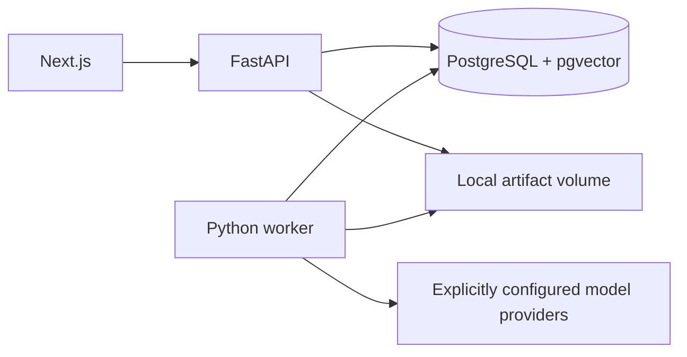

# Architecture

## Approved approach
A modular application plus separate worker in one repository. Next.js presents the UI; FastAPI validates requests and exposes resources; a Python worker performs heavy ingestion and experiments. PostgreSQL/pgvector stores metadata, jobs, normalized content, vectors, and results. Original files and exports live on a persistent local volume.

## Repository layout
apps/web/; services/api/; packages/rag_core/; services/worker/; migrations/; tests/; research/; skills/; docs/; infra/. Keep the Python core independent of HTTP/UI concerns. API and worker share schema/configuration and invoke the same pipeline modules.

Foundation creates apps/web, services/api, services/worker, packages/rag_core, migrations, tests, skills, infra, and scripts. research/docs directories arrive with artifacts. The worker processes durable ingestion, lexical/dense index builds, dense query previews, and saved experiment runs, rotating queue priority. Dataset curation/publication and bounded lexical inspection run in the API; durable retrieval and answer execution runs in the worker. Readiness verifies the exact migration revision and pgvector. Next.js proxies service status. Docker builds enable standalone output; native builds support ordinary next start.

## Pipeline
Upload draft → extraction/normalization → canonical sections with source locations → publication → chunk/index variant → dataset publication → immutable run manifest → retrieval → context packing → generation → evaluation → aggregation/export.
Index variants are keyed by corpus version, chunking configuration, embedding model revision, tokenizer, and normalization version. Retrieval does not alter corpus snapshots.

## Job execution
PostgreSQL-backed jobs use transactional claims with row locking, ownership tokens, lease expiry, and heartbeats. Expired jobs are reclaimable. Commit result/checkpoint only while holding current ownership; unique logical result keys prevent duplicate publication. Provider calls occur outside database transactions. At-least-once execution can repeat an external call after a crash, so cost estimates and ledgers must acknowledge that risk.

Persist pending/running/succeeded/failed/cancelled job states and queued/running/completed/completed_with_errors/failed/cancelled run states. Progress comes from checkpoints; UI polls initially. Cancellation is cooperative between stages/questions; an already running provider request may finish.

## Isolation and failure
Each question commits its own outputs. Stage errors are typed; ingestion/index failures have bounded retries; saved runs reclaim interrupted execution with a bounded ownership budget, while question-stage errors publish a failed observation and continue. Terminal errors retain evidence and logs with redacted secrets. Fatal dataset/configuration failures stop the run. Persist original and packed context separately to explain truncation.

## Deployment
Docker Compose starts web, API, worker, and database with persistent database/artifact volumes. One worker and bounded concurrency initially. Public deployment is outside the initial trust model and requires authentication and transport/security controls.

## References
- https://fastapi.tiangolo.com/tutorial/background-tasks/#caveat
- https://github.com/pgvector/pgvector

## M4 dense retrieval slice
Dense builds and query embeddings run in a bounded worker subprocess. The API validates and queues previews, then serves their durable state/result. The pinned CPU MiniLM contract includes model commit, dimension, normalization, precision, and library versions; vector publication adds safetensors/config/tokenizer artifact hashes and runtime metadata. Chunk/vector/manifest publication is atomic under a live lease. Exact cosine search reads only the selected compatible index and orders ties by chunk ordinal/ID; no ANN index exists. Completed previews are immutable, idempotent by index plus request hash, and distinct from saved experiment runs.

## Saved baseline execution
Migration 0007 separates immutable experiments, leased runs, append-only question_results, and retained run_attempts. It does not overload document ingestion jobs. Submission selects the exact published split and records code/lock/runtime identity. The worker refuses to execute a manifest under different code, locks, runtime, or model artifacts. API and worker therefore need matching images/settings; incomplete runs from old code require that matching environment or a new separately identified run.

Heavy embedding, model preparation and generation are bounded child processes outside database transactions. M4 uses the explicitly approved local CPU Qwen2.5 0.5B model with greedy decoding and a pinned safetensors snapshot. Gold/reference labels are scored independently and are never injected into the answer prompt. Prompt evidence is JSON text with [P1] references. It cannot authorize actions; no tool execution or remote model code exists.

A retrieval checkpoint commits before generation. Published results commit individually under live uncancelled ownership and a unique (run, question, repeat) key. Expired ownership marks unfinished attempts interrupted and skips already published observations. Cancellation kills an active child once observed and preserves completed results/checkpoints. API polling projects small scoring inputs/answer previews rather than loading all full prompts/evidence. The full trace is fetched only when inspecting one result.

The answer tokenizer recounts delivered passages and separators; the full rendered chat prompt must fit 2048 input tokens. Overflow is a typed error, never silent truncation. Generation is intentionally a small baseline whose answers may be inaccurate or lack citations. M5 provides answer-quality evaluators, hybrid retrieval, reranking, and paired analyses.

## M5 hybrid and reranking slice
Saved experiment retrieval_strategy selects the index baseline or a frozen hybrid pipeline over one ready dense index. The worker computes lexical candidates through that index's existing English tsvector and dense candidates with its compatible query embedding, fuses their one-based ranks with fixed equal weights, and optionally reranks the bounded fused shortlist. The API only validates configuration and queues runs; it never loads the cross-encoder.

cross-encoder/ms-marco-MiniLM-L6-v2 commit 233902d25c440f23af6f7d6e94d2946bac0bee0a is pinned with six artifact hashes and the existing CPU transformer runtime. Joint query/passage encoding includes special tokens and rejects >512 tokens before model inference. Scores are single-label logits with no sigmoid/softmax probability claim. Candidates and per-arm/fused rankings checkpoint before reranking; a crash or typed reranker error retains that evidence without falsely scoring final retrieval. Greedy answer generation and canonical gold scoring remain unchanged after the final passage selection.

Models, threads, batch size and timeout are recorded with code/lock identity, so resuming under different settings fails closed. Terminal M4 records are read as stored; new strategies produce new immutable experiment definitions/runs. M5 answer evaluation/review and paired statistics remain separate pending work.

## M5 answer evaluation
A fifth durable worker queue evaluates existing successful immutable answers. The API freezes rubric, result/input lineage and local evaluator execution identity, then returns immediately. Offline bounded judge children reuse pinned safetensors weights but use a separate evaluation prompt/contract, no provider credentials/tools and strict structured-output validation. Safe failure retains raw output/usage when available and never manufactures scores. Append-only human reviews use the same rubric scoring functions and stay independent of model estimates and prior dataset review. Read projections disclose latest-source coverage/disagreement; original runs/results are never backfilled. Model evaluation is optional via LOCAL_JUDGE_ENABLED; paid/remote providers remain unimplemented.

## M5 paired analysis and accounting
A sixth durable queue processes frozen paired-analysis snapshots. API submission projects run metrics/available attempt usage and selects explicit latest human/model records, while bootstrap computation stays in the worker. Comparison records bind execution identity and retain immutable input/output hashes, metric coverage, question/repeat/group lineage, scoring policies and exclusions. Reports aggregate repeats before resampling whole groups, block strict controls/coverage mismatches, label exploratory overrides, and preserve unavailable intervals/scores/cost. No API background task or model call is involved. New experiment cache notes are unverified operator declarations; actual per-call model lifecycle stays fresh CPU child processes. Existing runs/reviews/indexes remain unchanged.

## M6 dashboard and export boundary
Migration head is 0010_exports. The worker rotates seven durable queues, adding leased evidence exports to ingestion, indexing, dense previews, runs, answer evaluations and comparisons. APIs freeze bounded identifiers and immutable input projections; the worker streams archive entries, hashes bytes and atomically publishes a lease-specific ZIP. The artifact volume retains exports through service restarts. Download responses stream the ZIP through the Next.js proxy.

Filtered comparisons freeze topic/difficulty and recompute paired analysis on the selected questions. Selected stage timing samples are separate from full-run usage/accounting. Diagnostics project bounded frozen question/repeat observations and current explicit assessment-source signals, linking to exact saved results. The demo is a static client workflow independent of APIs or submission controls.
