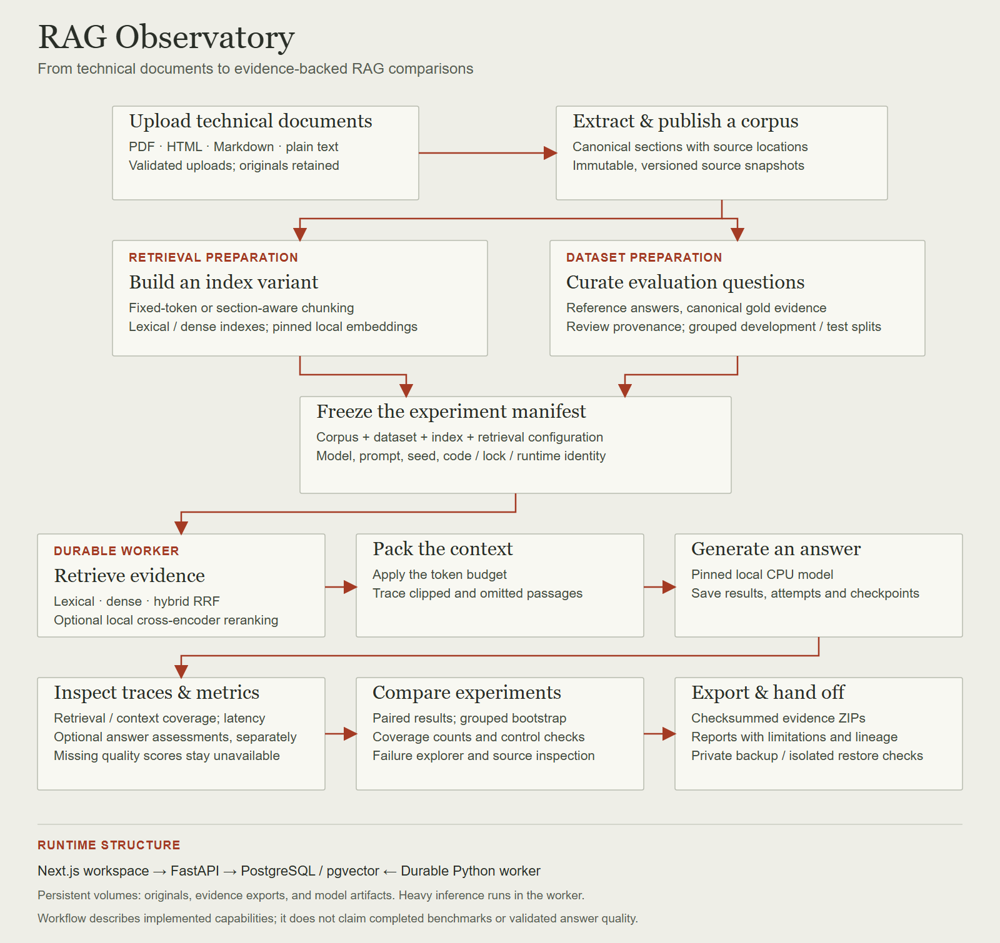
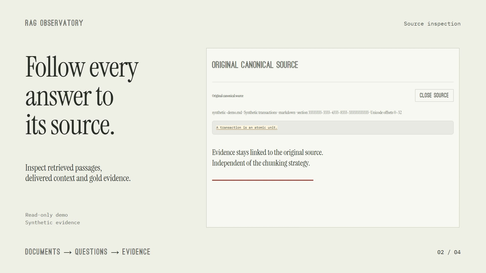

# RAG Reliability & Evaluation Platform

A research-oriented full-stack platform for uploading technical documents, building evidence-annotated datasets, running controlled RAG experiments, and investigating failures.

**Current status: M1-M7 delivered under the exploratory research scope (2026-10-20).** The platform supports document ingestion, reviewed datasets, local CPU RAG experiments, evidence inspection, paired comparisons, and checksummed exports. The PostgreSQL18.0 benchmark completed840 development and1,080 held-out observations with zero execution failures, eight exploratory comparisons, and16 verified evidence exports. A post-experiment private backup passed isolated restoration.

Read the [benchmark report](research/postgresql-18.0/BENCHMARK_REPORT.md) and [delivery checklist](research/postgresql-18.0/DELIVERY_CHECKLIST.md). **Answer quality remains unvalidated**: correctness, faithfulness, citation support, and abstention quality have no validated findings; improved factual accuracy is not established. Gold source reviews comprise10 human and140 AI reviews. Retrieval measurements and observed latency are reported with coverage and limitations; local financial/energy cost is unavailable.

## Project workflow



Index preparation and dataset curation independently use the published corpus, then join in an immutable experiment manifest. Heavy retrieval and inference execute in the durable worker; the dashboard exposes saved traces, comparisons, and evidence exports. Answer assessments are optional and separate from retrieval metrics; unavailable scores remain unavailable.

This diagram describes the implemented workflow. Completed exploratory delivery does not establish validated answer quality. [Open the editable vector diagram](docs/assets/project-workflow.svg) · [Read the architecture](ARCHITECTURE.md).

## Product walkthrough

[](docs/assets/rag-observatory-demo.mp4)
https://github.com/user-attachments/assets/24d3be15-beaf-4ed3-9fa4-dfcec85602c2
[Watch the video](docs/assets/rag-observatory-demo.mp4) · 22 seconds · 1080p with audio. The walkthrough shows the synthetic read-only demo and an excerpt from the PostgreSQL study. Retrieval findings are exploratory; answer quality remains unvalidated. [Media credits](docs/assets/rag-observatory-demo-credits.txt).

## Reading order
1. PRD.md, USER_FLOWS.md, REQUIREMENTS.md — product and scope.
2. DESIGN_SYSTEM.md, ARCHITECTURE.md, API_SPEC.md, DATA_MODEL.md — design contracts.
3. RESEARCH_PROTOCOL.md, DATASET_CARD.md — experiment integrity.
4. IMPLEMENTATION_PLAN.md, TASKS.md, ACCEPTANCE_TESTS.md — delivery milestones.
5. AGENTS.md, skills/, CODEX_HANDOFF.md — persistent agent context.
6. TESTING.md, CONTRIBUTING.md, SECURITY.md — quality and safety.
7. DEPLOYMENT.md, DECISIONS.md, .env.example — operations and rationale.

## Run locally

Start with the [quickstart](docs/QUICKSTART.md): a frontend-only synthetic demo needs Node/npm, while a new full workspace adds Docker and pinned local model downloads. It includes a small [development fixture](examples/transactions.md) and a guided one-question experiment. A clone does not include the private M7 database or model cache.

Prerequisites: Node 24, npm, and uv. Python 3.12 is selected in .python-version; uv can provision it. Docker with Compose is required for the full database-backed environment. Windows: use npm.cmd if PowerShell blocks npm.ps1.

```powershell
if (-not (Test-Path .env)) { Copy-Item .env.example .env }
uv sync --frozen
npm.cmd ci
```

If .env already exists, preserve it and update settings as needed. Start the API and dashboard in separate terminals from the root:

```powershell
uv run uvicorn rag_api.main:app --reload --host 127.0.0.1 --port 8000
```

```powershell
npm.cmd run dev
```

Open http://127.0.0.1:3000 and API documentation at http://127.0.0.1:8000/docs. Without PostgreSQL, the shell works and reports unavailable database/worker services. The shell needs no model credentials; dense inspection downloads its pinned public local model. See DEPLOYMENT.md for database setup and production-mode commands.

For ingestion with a native API/frontend and Docker database, start these from the root:

```powershell
docker compose up -d db
uv run alembic upgrade head
uv run rag-worker
```

Keep the worker in its own terminal. In Documents, create a corpus, upload a file, wait for Ready, inspect the source text, then publish a version. Originals are retained; duplicate content in the same corpus reuses its document and job. Encrypted PDFs and scans requiring OCR fail explicitly. Extraction defaults: 50 MB uploads, 1,000 PDF pages, 2 million source characters, and a 60-second parser timeout. Linux parser processes also enforce a 1 GiB address-space limit; native Windows currently enforces the wall-clock and document limits.

With Docker available and .env prepared:

```powershell
docker compose up --build
```

Compose defines PostgreSQL/pgvector, a one-shot migration, API, worker, and web. Container builds and full startup are verified locally. Stop native API/web previews before using their same Compose ports. Named volumes retain the database and originals across restarts.

## Quality checks
```powershell
uv run ruff check .
uv run ruff format --check .
uv run mypy
uv run pytest
npm.cmd run check
npm.cmd run build
node node_modules/@playwright/test/cli.js install chromium
npm.cmd run test:e2e
```

Database integration tests require a disposable database via TEST_DATABASE_URL; otherwise they explicitly skip. See TESTING.md. Husky runs staged lint/format checks. Dependencies are locked in uv.lock and package-lock.json.

## Stack
Python 3.12, FastAPI, PostgreSQL/pgvector, Next.js 16.4, React 19.3, Docker Compose. sentence-transformers and transformers use locked CPU dependencies. M4 answer generation uses the explicitly enabled pinned local model; paid adapters are not implemented. The labeled read-only demo remains planned for dashboard completion.

## Research claims
Local development-fixture runs have executed; no research benchmark or method superiority has been established. Model-judge metrics are estimates. The benchmark will publish actual provenance, controlled settings, evidence, uncertainty, and limitations.

## Curate a dataset
In Datasets, choose a published corpus and create a dataset. Use Development fixture for software checks; use Research dataset for owner-reviewed benchmark labels. Add question text, reference answer, required facts, and source annotations. You can select text or enter character offsets; whole-section selection supports keyboard use. Multiple passages can jointly support a fact, with alternatives when different evidence suffices.

Assign topic, difficulty, development/test split, and a split group. Explicitly record the reviewer after inspecting the answer and all evidence. Editing a saved answer/annotation clears the editor's review flag. Publish only after all questions pass validation; prior exports remain unchanged by later edits. JSONL import is atomic and reports line errors. Export JSONL downloads from each published version. See API_SPEC.md for the schema and source-span conventions.

The bundled authored development question was explicitly reviewed by the project owner and published as a one-question development fixture. It is not the PostgreSQL research benchmark.

## Inspect lexical retrieval
In Experiments, choose a published corpus and select section boundaries or fixed token windows. Fixed windows may cross sections within one document; section chunking splits oversized sections within their own boundaries. Set a token limit and smaller overlap, then build the index. The worker persists the job, downloads only a pinned tokenizer, and publishes all chunks atomically. Repeating the same configuration reuses the index; failed builds can be retried.

Select a ready index, enter document terms, and choose a context budget. The preview shows the top five matching passages, the exact delivered context, truncation/omission counts, and canonical source excerpts. Search uses PostgreSQL English full-text search and ts_rank_cd, not BM25. Lexical rank is not an accuracy score. Preview requests do not generate answers or save experiment results.

Tokenizer: sentence-transformers/all-MiniLM-L6-v2 at commit 1110a243fdf4706b3f48f1d95db1a4f5529b4d41, with tokenizer artifact SHA-256 and library version recorded in each index manifest. No model weights are downloaded by lexical builds. The context budget covers delivered document text and separators; saved generation uses the pinned answer tokenizer and separately bounds the complete chat prompt.

## Inspect dense retrieval
In Experiments, select Dense under Retrieval method, build a published corpus with a chunk limit at most 254 tokens, then inspect retrieval. The first build downloads the pinned public MiniLM safetensors snapshot; subsequent query inference uses the local cache. The worker embeds locally on CPU, persists normalized 384-dimensional vectors in pgvector, and queues query previews with retry/recovery. Inspect source spans and delivered context as with lexical retrieval. Cosine similarity is not a quality metric. No answer generation or paid provider is required.

Defaults: two inference threads, batch size 16, 10000 dense chunks, 5 million input characters per embedding batch, 120-second model subprocess timeout. Compose bounds the worker to four CPUs/4 GiB. Oversized text fails instead of silent model truncation; reduce chunk/query size or change explicit limits within supported bounds. Frozen manifests retain the model commit, artifact hashes, runtime, and library versions. Compare strategies using the same corpus and chunk configuration when drawing research conclusions.

## Run and inspect a baseline
Set LOCAL_GENERATION_ENABLED=true in the server-side .env, then rebuild/start the API and worker with matching code and settings. No paid API key is needed. The first run prepares the public Qwen2.5-0.5B-Instruct snapshot; model caches persist in the models volume. M4 accepts this fixed local CPU contract, not arbitrary model overrides. Defaults: two threads, 300-second child timeout, 1024 evidence tokens, 128 output tokens; full input limit 2048 tokens, evidence maximum 1536.

In Experiments, select a published reviewed dataset, a ready index from the same corpus, and its development/test split. Name the experiment and Start run. The worker generates fresh answers, scores original retrieval and delivered-context evidence independently, and saves each question-repeat observation. Open /runs/{id} for progress, cancellation, metric coverage, original/gold/delivered sources, prompts, token counts, raw answers, stage timings and attempts. Download the immutable input manifest from that page.

The model is small: it may hallucinate, omit citations, or refuse without the exact abstention marker. Original run records expose those outputs with answer scores unavailable at execution time; separate post-hoc answer evaluations now support explicit rubric-based human/model assessments. Local compute cost is also unavailable. Greedy repeats are fresh timing executions, not independent research questions. Individual generation times include hashing/loading; queue time and shared model preparation are outside question-stage timing. Run timestamps provide a broader execution window. Controlled latency/cost summaries arrive in M5.

Cancellation preserves completed observations. Worker recovery skips their unique keys and repeats interrupted work under a new lease. Terminal runs are immutable; create a fresh run for another execution. Set SOURCE_REVISION to the actual Git revision (include a dirty qualifier if appropriate) before measured runs; source-file/lock hashes are always captured. Worker/API code and runtime must match a frozen manifest to resume it.

## Run hybrid retrieval and reranking
In Experiments select Hybrid reciprocal-rank fusion or Hybrid fusion + cross-encoder. Both need a ready dense index matching the published dataset: its exact same frozen chunks supply lexical and dense candidates. Set final retrieved passages, candidate depth (at least final top-k; maximum 50), and the RRF constant (default 60). The candidate depth applies to each search arm and to the fused shortlist passed to the reranker. Equal arm weights are fixed in this version.

Hybrid adds 1/(constant + one-based rank) from each arm, counting a chunk once per arm. The worker reranks the best fused candidates with pinned cross-encoder/ms-marco-MiniLM-L6-v2 on CPU when selected. The first reranked run prepares its public 90.9 MB safetensors snapshot; no paid provider or new API credential is needed. RERANKER_THREADS=2, RERANKER_BATCH_SIZE=8 and RERANKER_TIMEOUT_SECONDS=120 are defaults. Each actual query/passage pair must fit 512 model tokens including specials; overflow fails rather than silently truncate. Existing model-ID environment placeholders do not override the fixed contract.

Open the saved question trace for both arm ranks, fused scores, raw reranker logits, final selected rank, token counts/runtime, and original source for retained candidates. RRF scores and logits are ranking signals, not probabilities or answer quality. A lexical AND-term query can return no passages; this is disclosed rather than silently substituting a different query. Reranking failures retain candidate checkpoints and leave final retrieval metrics unavailable/error-counted. M5's paired statistical comparison and timing/cost analysis remain pending.


## Evaluate a saved answer
Open a saved run, select a question result, and choose **Evaluate this answer**. Inspect the frozen answer, reference facts and delivered evidence. **Add human review** records your explicit fact/claim/citation assessments, reviewer label, rationale and review confirmation. Earlier reviews stay visible; gold-question approval never approves the generated answer.

Optional `LOCAL_JUDGE_ENABLED=true` enables the pinned local CPU Qwen self-judge in the durable worker. Restart API and worker with matching source/settings; no paid API is used. It reuses existing cached Qwen weights offline. `.env.example` defaults to disabled; human review is available either way. Read the rubric and keep model estimates separate from human judgments. The tiny self-judge is uncalibrated: the actual development-fixture smoke produced invalid rubric output, correctly retained as failed with unavailable scores. Inspect raw output/usage and do not treat a judge response as objective truth.

Expanded answer evaluations show applicable/scored/error/unavailable counts for the run, latest human/model assessments, denominators, and disagreements. They are separate post-hoc records; original run traces/metrics stay unchanged. Means count observations, not independent questions. Paired/bootstrap and observed stage-timing summaries are implemented. Cache/shared-host timing is uncontrolled; local financial/energy cost remains unavailable.


## Compare saved runs
Open Comparisons, choose two saved runs, select explicit human reviews or model estimates, and create an analysis. The worker freezes the selected evaluations and computes question means before a seeded 95% percentile bootstrap of whole split groups. The saved report keeps its inputs, sample/exclusion counts, compatibility differences, and uncertainty. Later reviews do not change it. Incomplete scoring or differing controls block strict analysis; an explicit exploratory submission retains a warning. Missing repeats, question revisions or scoring-policy mismatches never become zero-filled pairs. A single split group has no confidence interval.

Timing tables show observed p50/p95, sample/missing counts, run windows, attempt usage and uncertainty. These are sample measurements, not portable performance guarantees. Answer models load in fresh CPU child processes. Advanced experiment controls let operators record cold/warm cache preparation notes; declarations are unverified, and older runs say not recorded. New index builds time extraction-to-index work before publication; old build durations remain unavailable. Local compute cost and pricing are unmeasured/unavailable. No accuracy/latency winner is inferred from the one-question development fixture. Full charts, topic/difficulty filters, failure explorer and full exports are M6 work.

## Dashboard and evidence exports
Open [comparisons](http://localhost:3000/comparisons) to create immutable paired reports filtered by topic/difficulty, inspect coverage and latency charts, and download an evidence ZIP. Saved runs link to a failure explorer and exact answer/source traces. [Read-only demo](http://localhost:3000/demo) works without the API and uses explicit synthetic software fixtures, without inference or submission actions.

Exports include frozen manifests/results/assessments, canonical corpus text, index chunks/vectors, and checksums. They exclude original upload binaries and model weights. Historical code bytes are included only when their hashes match; provenance/availability.json explicitly lists unavailable files. These artifacts support evidence inspection and do not guarantee a complete historical runtime. Live data remains one reviewed development question; benchmark acquisition, annotation and actual research experiments are M7.

## M7 exploratory delivery — 2026-10-20

The official PostgreSQL18.0 subset contains40 documents and2,013 canonical sections. The published150-question benchmark uses a frozen105/45 grouped split with10 human/140 AI gold source reviews. Same-assistant curation is not independent validation; see [curation review](research/postgresql-18.0/CURATION_REVIEW.md) and [dataset card](DATASET_CARD.md).

All eight development configurations completed105 observations each. All eight held-out configurations completed45 questions ×three repeats each. Eight exploratory paired comparisons and16 worker evidence ZIPs completed with checksums verified. The [report](research/postgresql-18.0/BENCHMARK_REPORT.md) preserves unavailable answer-quality scores, group-based uncertainty, sample counts, and uncontrolled timing/cost limitations.

The final private backup passed a manifest-bound isolated restore:23 tables,100 artifact files,86 model files,41 originals,17 total historical/current exports,22 saved runs and11 comparisons verified. See [backup and restore](BACKUP_RESTORE.md). The backup contains secrets and remains under ignored `data/`; never publish it. Same-machine recovery does not prove offsite recovery or inference replay. The snapshot precedes terminal receipt/document updates.

## Frontend

Open [the local landing page](http://localhost:3000/), [the research workspace](http://localhost:3000/experiments), or the clearly synthetic [read-only demo](http://localhost:3000/demo). Instrument Serif/Ostrich Sans are bundled locally; technical evidence uses monospace. Light/dark/system themes, finite GSAP transitions and Lenis scrolling support reduced motion. Earlier native preview ports3001/3002 are historical builds. See [design system](DESIGN_SYSTEM.md).

## License and release status

Original code uses [Apache-2.0](LICENSE); see [NOTICE](NOTICE) and [third-party notices](THIRD_PARTY_NOTICES.md) for dependencies, fonts, models and source-document exceptions. GSAP has its own non-OSI standard license; do not describe the entire dependency stack as Apache/MIT-only. Models are downloaded separately, not bundled. The [release checklist](docs/RELEASE_CHECKLIST.md) records what has been verified and what remains before a public release.
